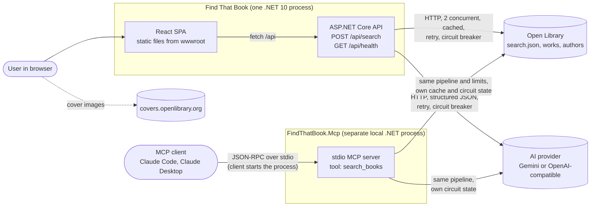

# System context

The MCP server runs the same search pipeline as the API in its own process. It has no auth, rate limit or HTTP transport, and it is not part of the Docker image. See [03-search-flow.md](03-search-flow.md).
