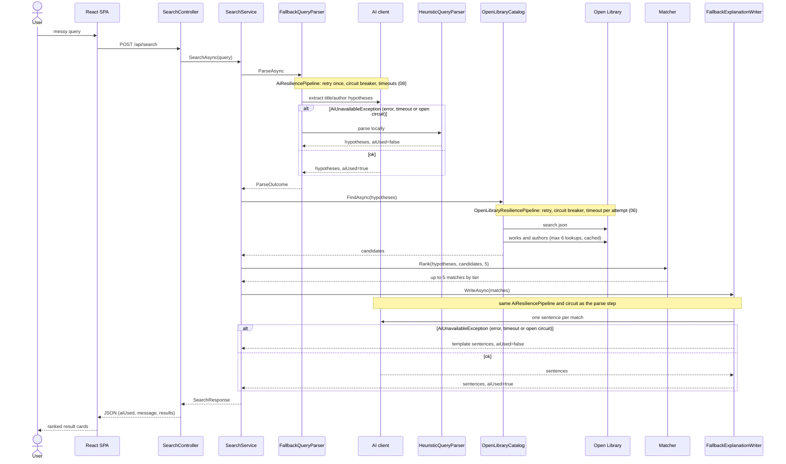
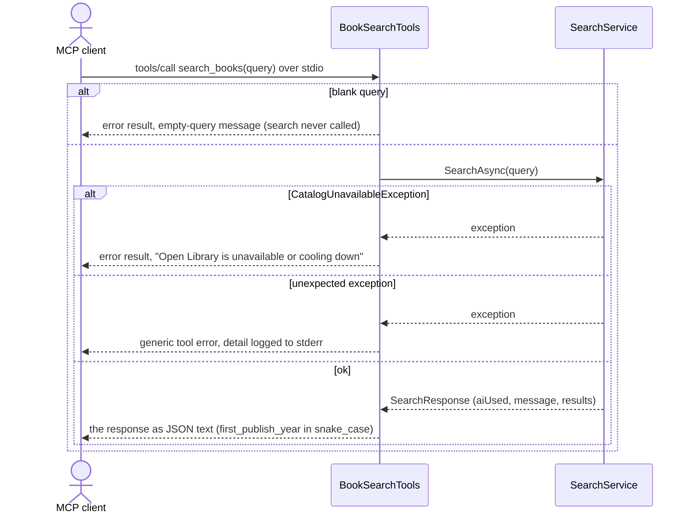

# Search request flow

## Search through the MCP server

The MCP tool enters the same pipeline at `SearchService`. Everything after `SearchAsync` in the diagram above is unchanged.

`AiUnavailableException` never reaches the tool. The fallback decorators handle it and the response carries `aiUsed: false`.
