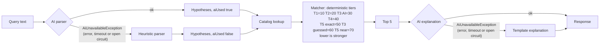

# Matching and fallback design

Ranking never uses the AI. The AI only extracts the query and writes explanations.

While the AI circuit is open (see [08-ai-resilience.md](08-ai-resilience.md)), both AI steps fail at once, so a search takes the non-AI path without waiting for a timeout. Open Library has no fallback: an open Open Library circuit (see [06-open-library-protection.md](06-open-library-protection.md)) fails the search with a 502.
