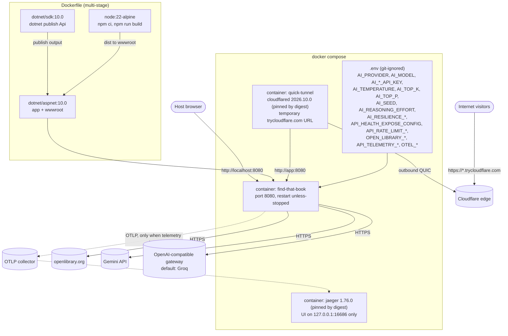
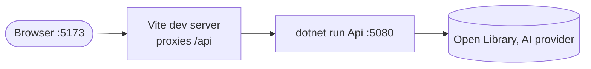
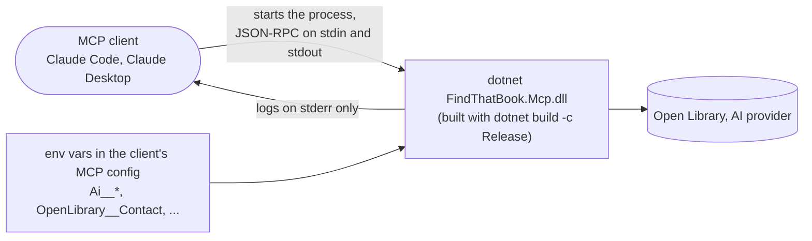

# Infrastructure and deployment

## Docker

## Local development

## MCP server

The MCP server is not in the Docker image or `docker-compose.yml`, which publish only the API. It reads environment variables, not `.env`, user secrets or an `appsettings.json` (the host's content root is its own folder). Start it from a built dll, not `dotnet run`, and use an absolute path when the client does not start it from the repository root.

`dotnet run` reads env vars, not `.env`. See [07-telemetry.md](07-telemetry.md) for what is exported. Only `docker compose` reads `.env`.
