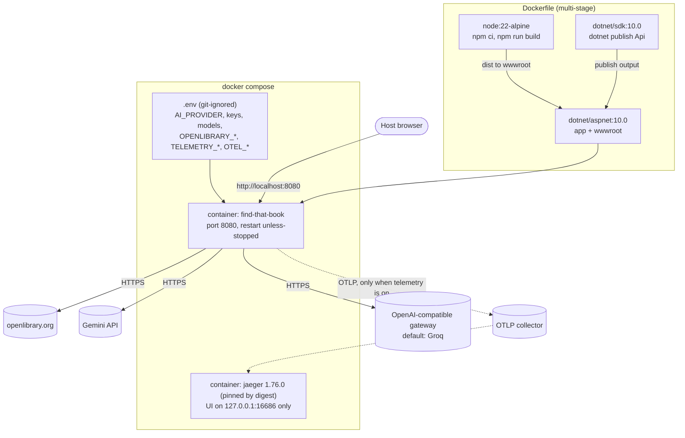

# Infrastructure and deployment

## Docker

## Local development

`dotnet run` reads env vars, not `.env`. See [07-telemetry.md](07-telemetry.md) for what is exported. Only `docker compose` reads `.env`.
