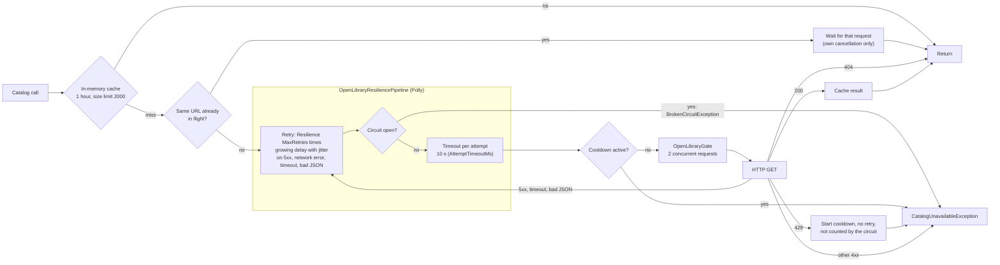

# Open Library protection

Every attempt to reach Open Library runs through `OpenLibraryResiliencePipeline` (Polly, one instance for the process, so the circuit state is shared). Strategies, outermost first: retry, circuit breaker, timeout per attempt.

The circuit opens when at least half of the requests in 30 seconds failed, with at least 6 requests (`OpenLibrary:Resilience:CircuitBreaker*`). It stays open for 20 seconds, then lets one request through. While it is open, searches fail with a 502 and send no request. Opening and closing are counted by `ftb.openlibrary.circuit`.
