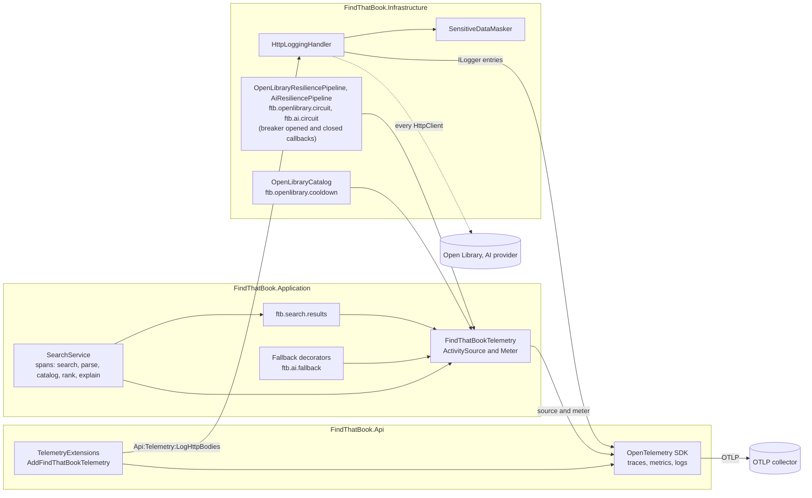

# Telemetry

Off unless `Api:Telemetry:Enabled` is true or `OTEL_EXPORTER_OTLP_ENDPOINT` is set.

The MCP server (`FindThatBook.Mcp`) registers no telemetry and no HTTP body logging, because those are set up by `TelemetryExtensions` in the API, not by `AddFindThatBook`. Its logs go to stderr only.

`HttpLoggingHandler` masks first and truncates second (8 KB), so a secret cut in half is never logged.

The circuit counters (`ftb.ai.circuit` and `ftb.openlibrary.circuit`, tag `state` with `opened` or `closed`) are recorded from the circuit breaker callbacks of the two Polly pipelines, through `FindThatBookTelemetry`. The Polly meter itself is not subscribed.
