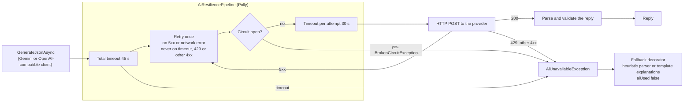

# AI resilience

Every AI HTTP call, for Gemini and for OpenAI-compatible endpoints, runs through `AiResiliencePipeline` (Polly, one instance for the process, so the circuit state is shared by the parse and explain steps). Strategies, outermost first: total timeout, retry, circuit breaker, timeout per attempt. Settings are in `Ai:Resilience` (`AI_RESILIENCE_*` for Docker Compose).

The circuit opens when at least half of the calls in 30 seconds failed, with at least 4 calls. A 5xx, a network error, a timeout and a 429 count as failures. It stays open for 30 seconds, then lets one call through. While it is open, a search skips the AI at once instead of waiting for a timeout. Opening and closing are counted by `ftb.ai.circuit`.
