# UI Tests

Scope: the by-hand tests run on the featured results layout (UI spec D20), the toast messages and the search progress stage, what they showed, and what is still open. Decisions are in `docs/ui-proposals/ui-spec.md`. Date of the by-hand run: 2026-10-09 (sixth run, with the browser's reduced-motion setting off, so the stage scenes moved in the screenshots).

## 1. By-hand tests

Environment: headed Chrome driven through the Claude in Chrome extension. The UI was the Vite dev server (`npm run dev` in `web/`, port 5173, proxying `/api` to the API on port 5080). The API ran with no AI settings, so every real search used basic parsing and showed the "Basic search mode" toast on its own. Real query: `tolkien hobbit`, 5 books. The layout under test does not depend on that. The error, loading, single-result, weak-match and empty scenarios used a stubbed `fetch` inside the page, because those states cannot be triggered on demand with a healthy backend.

The browser window resize does not change the page viewport, so every width below the desktop shot was tested in a same-origin iframe of that width (the iframes were scaled down only for the screenshot). Media queries react to the iframe width, so this matches a real window of that width, but it does not test touch. Give each iframe `flex: none`, or a flex row shrinks it below its set width. In this run the browser reported `prefers-reduced-motion: no-preference`, so the stage scenes moved and each screenshot caught them mid-animation. In the previous run of the same day the setting was on and the scenes were static. For the reduced-motion check (T20) the `@media (prefers-reduced-motion: reduce)` rules were forced on inside the iframe by setting each rule's `media.mediaText` to `all`. The theme was set with the `data-theme` attribute on the iframe's `<html>`, so the System, Light and Dark toggle inside those frames does not highlight the active theme. That is a test harness effect, not a product bug.

### 1.1 Matrix

| ID | Width | Theme | What was checked | Result |
|----|-------|-------|------------------|--------|
| T1 | Desktop (1451px window) | Dark | Layout, badges, covers, chips, notice toast | Pass |
| T2 | 1024px | Dark, light | Featured card 200px cover plus text, other matches in 2 columns, no horizontal overflow | Pass |
| T3 | 768px | Dark, light | Same as T2 | Pass |
| T4 | 390px | Dark, light | Featured card 110px cover, other matches in 1 column, chips scroll sideways, no horizontal overflow | Pass |
| T5 | 320px | Dark, light | Same as T4, title and reason wrap, no horizontal overflow | Pass |
| T6 | 1024, 768, 390, 320px | Light | Every "Why this book?" opened: reasons show inside the cards and do not break the layout | Pass |
| T7 | 1024, 768, 390, 320px | Dark, light | Badges, text and card borders readable | Pass |
| T8 | 1024, 390, 320px | Dark | Error toast (forced 502): announced as an alert, shows title, message, Try again and Dismiss, covers nothing | Pass |
| T9 | 1024, 768, 390, 320px | Dark, light | Toasts sit at the bottom of the screen, cover no part of the logo, heading, search box or chips, and clear the last result at the end of the page (0px covered) | Pass |
| T10 | 1024, 390px | Dark | Dismiss removes the toast. Try again repeats the search, removes the error toast and shows the result (here the empty-state toast and the bookshelf). Try again is focusable | Pass |
| T11 | 1024 (dark), 768, 390, 320px (light) | Dark, light | Search progress stage while a search runs: it replaces the results skeleton, nothing overlaps, no horizontal overflow | Pass |
| T12 | 1024, 390px | Dark, light | Single-result search: featured card only, no "Other possible matches" section, no toast | Pass |
| T13 | 1024, 390px | Dark, light | Empty state is an info toast with the message and the tip "Try just the author's last name, or fewer words.", no leftover text block, nothing covered | Pass |
| T17 | 1024, 390, 320px | Dark, light | Empty state also shows the empty bookshelf picture under the search box, the toasts do not cover it, no horizontal overflow. A real empty search (`qzxwvkj plmnb`, no stub) shows it too | Pass |
| T14 | 1024, 390px | Dark | Weak-match message ("No confident match…") is an info toast titled "Closest results" next to the results | Pass |
| T15 | 1024, 768, 390, 320px | Dark, light | AI notice alone, info toast alone and both stacked: nothing covered at the end of the page, no horizontal overflow (24 combinations) | Pass |
| T16 | 390px | Dark | The four steps show in order, each with its own animated scene (magnifier over the query, library with radar rings, clues linked to book spines, quill writing lines), a title, a detail line and four chips that go from pending to active to done | Pass |
| T18 | 390px | Dark | Motion: the lens, rings, flying books, link lines, check, growing lines, quill and the active chip all change value from sample to sample (42 samples over 10.5 seconds: 7 lens, 10 ring, 10 flying book, 7 link, 5 check, 7 growing line, 14 quill and 36 chip values). Four frames started 0.7 seconds apart show the lens, the highlighted text line, the sparkles and the chip pulse at different moments, and one catches the cross-fade into the next scene | Pass |
| T19 | 390px | Dark | Slow state: after 10 seconds all four chips are done, the title reads "Still working, this is taking longer than usual…", the detail reads "Open Library or the AI gateway may be slow right now.", and the last scene stays | Pass |
| T20 | 390px | Dark | Reduced motion (emulated by forcing the reduced-motion rules on in a frame): all eight sampled values stay constant (one value each, the lens sits at 70px, 56px for the whole run) while the text, chips and step changes still work. Seen live in the previous run, when the browser itself had reduced motion on | Pass |

Measured values (`getComputedStyle`, `scrollWidth` and `clientWidth`), dark theme, iframes 900px tall:

| Width | Featured columns | Other matches columns | `scrollWidth` vs `clientWidth` |
|-------|------------------|-----------------------|-------------------------------|
| 1024 | 200px 582px | 424px 424px | 1009 = 1009 |
| 768 | 200px 435px | 350.5px 350.5px | 753 = 753 |
| 390 | 110px 193px | 347px | 375 = 375 |
| 320 | 110px 123px | 277px | 305 = 305 |

The light theme gave the same values at every width. `clientWidth` is the iframe width minus its 15px vertical scrollbar. The page is taller than the iframe at every width, so the scrollbar is always there. Equal values mean no horizontal overflow.

### 1.2 Screenshots

Desktop, dark, with the "Basic search mode" toast at the bottom right (T1):

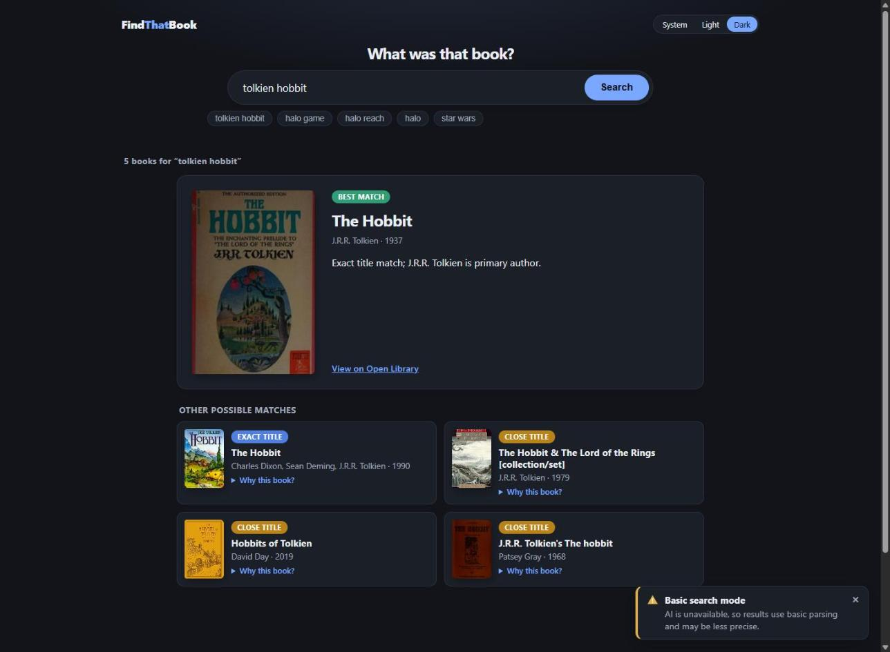

1024, 768, 390 and 320px side by side, dark (T2 to T5, T9). The toast sits at the bottom at every width:

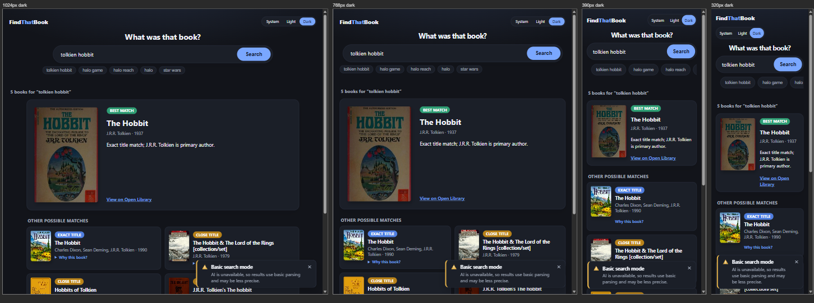

The same widths in light mode, scrolled to the results, with every reason opened (T6, T7):

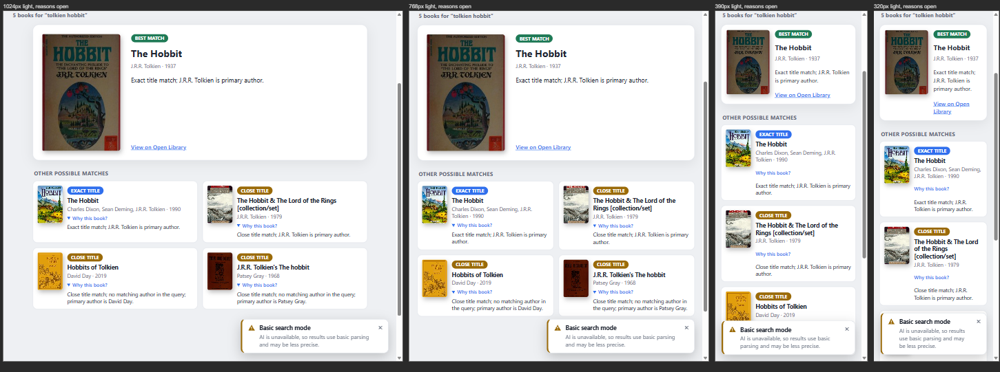

The error toast at 1024, 390 and 320px, dark (T8, T9). On phones it spans the bottom of the screen and leaves the header, heading, search box and chips visible:

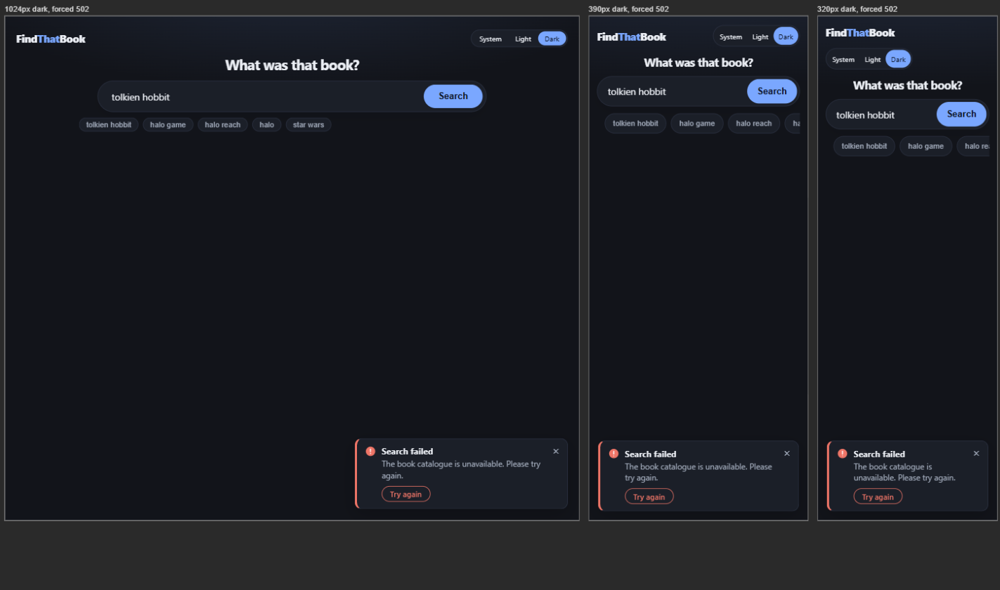

The four steps of the search progress stage at 390px, dark, left to right (T16). Each frame was started 2.5 seconds after the previous one, and the shot was taken about 1.5 seconds after the scenes changed, so every scene is mid-animation (the lines are half drawn, the quill is partway across):

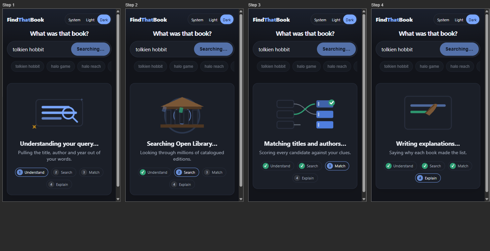

The stage while a search runs at 1024px (dark), and at 768, 390 and 320px (light) (T11). The results area is the stage itself, no skeleton is shown:

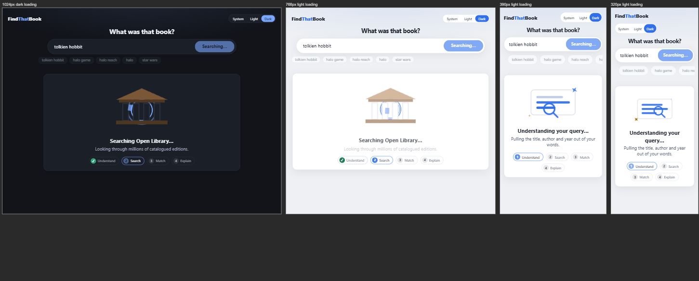

A single-result search at 1024 and 390px, dark and light (T12):

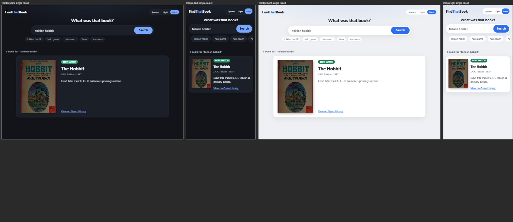

Left to right: weak-match results with the AI notice stacked above the info toast at 1024px and at 390px (dark), the empty state at 1024px (dark, toast and bookshelf), and the empty state with the AI notice at 390px (light). The toasts are fixed to the screen, so on the two left frames they float over the results (T13, T14, T15):

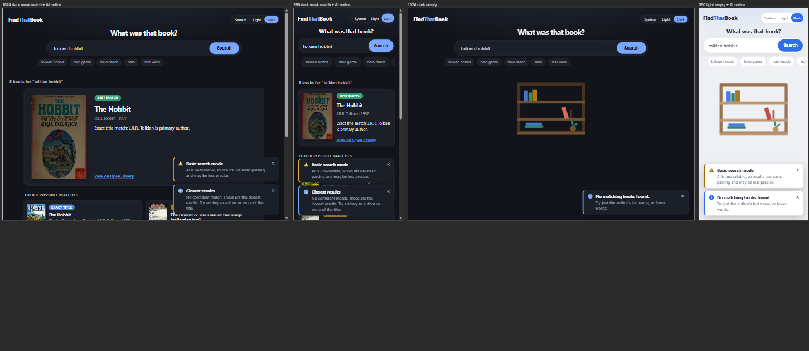

The stage with motion on at 390px, dark, step 1 (T18). Four frames started 0.7 seconds apart, so they show four moments: the lens is at a different place each time, the sparkles and the chip pulse, and the right frame is cross-fading into the next scene:

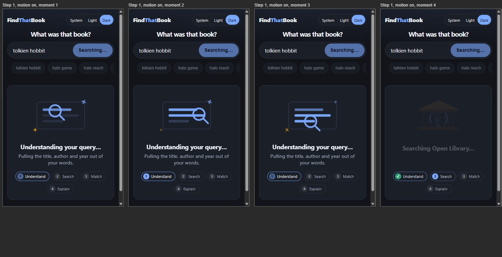

The slow state after 10 seconds at 390px, dark (T19). The quill is still writing:

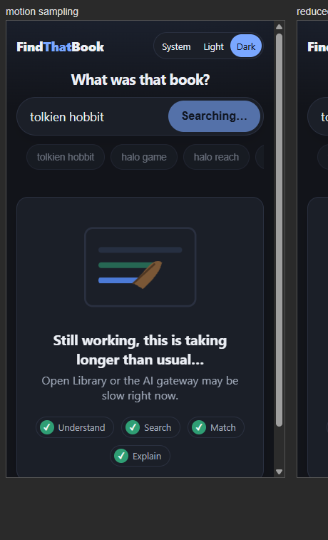

The empty state with the bookshelf picture at 1024px (dark), 390px (dark), 1024px (light), 390px and 320px (light) (T17, F4):

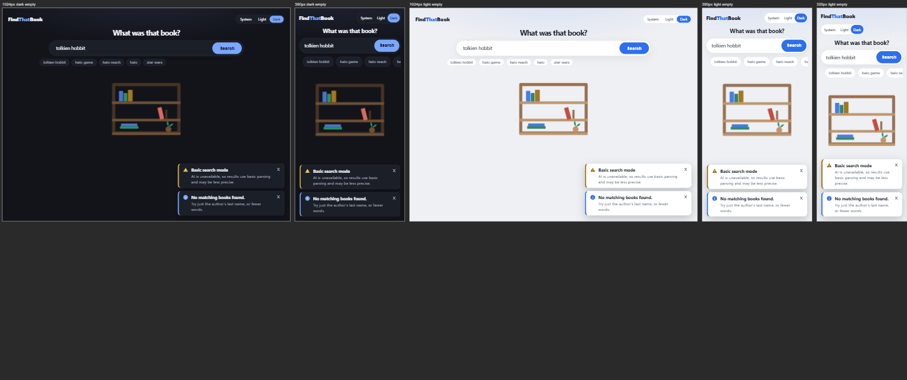

## 2. Findings

| ID | Finding | Severity | Status |
|----|---------|----------|--------|
| F1 | On desktop the featured card has an empty gap between the explanation and the "View on Open Library" link, because the link sits at the bottom of the card next to the tall cover. Still visible in this run | Low, cosmetic | Open |
| F2 | On phones (390px and 320px) the toast was fixed at the top of the screen and covered the logo, the theme toggle and the heading. Fix: on phones the toast now sits at the bottom, and while any toast is showing the page gets 260px of bottom padding (`.page:has(.toast)`) so the last result is not hidden behind the stack. Re-measured in this run at 1024, 768, 390 and 320px in dark and light (T15): 0px of the last result covered | Medium | Fixed |
| F3 | `/api/health/ready` reported the OpenAI-compatible endpoint as `ok` (the `GET /models` probe passed), but the real search fell back to non-AI parsing in an earlier run. The probe does not prove that the chat call works. This run had no AI settings, so it was not retested | Medium | Open |
| F4 | A search with no results left the area under the search box blank, and the only message was a toast in the corner. Fix: the empty state now also shows a picture of a mostly empty bookshelf (`EmptyShelf`, an inline SVG with `role="img"`) under the search box. It stays after the toast is dismissed. The message itself is still only the toast. Checked at 1024, 390 and 320px in dark and light (screenshot 09): the shelf sits above the toasts and nothing overflows sideways | Low, design | Fixed |

## 3. Not tested (pending)

| ID | Item | Why it matters |
|----|------|----------------|
| P1 | Real touch behavior on a phone | Iframes do not trigger `hover: none`, and the `
` tap target is only measured by its CSS (36px minimum). The toast dismiss target is a 1.3rem glyph with 4px side padding and its size was not measured. A toast at the bottom of a real phone screen may also sit behind the browser's bottom bar, which iframes cannot show |
| P2 | The error toast in light mode, and the empty-state toast at 768 and 320px | The error toast was only seen in dark. The empty-state toast was seen at 1024 (dark) and 390px (light) only |
| P3 | Widths below 320px, and landscape phones | The old layout had a 340px breakpoint, the new one has only 760px |
| P4 | Screen reader behavior of the heading order (`h2` count, `h3` featured title, stage title and "Other possible matches", `h4` card titles), of the `
` disclosure, of the stage status region and of the toast announcements | Checked by reading the markup and by unit tests, not with a screen reader |
| P5 | Keyboard walk through the page (Tab order, focus ring on the covers, links, `summary` and the toast buttons) | Only focusing Try again from script was tried, not a real Tab walk |
| P6 | Progress stage motion quality: motion was checked by sampling computed values every 250ms and by stills, not by watching or recording it | Sampling proves the scenes move, it does not show smoothness, frame rate or flicker |
| P7 | The earlier shelf, ranked list and featured plus rest layout prototypes and the four message styles (banners, toast, balloon, modal) were not kept on a throwaway branch. The progress variants (current panel, stage, floating dock, shelf) are on the branch `prototype/search-progress-variants`, switch with `?variant=A` to `D` | The older comparisons cannot be repeated without rebuilding them |
| P8 | A real failed search, without a stubbed `fetch`, and a real weak-match search | These states were only seen with a stubbed response. A real empty search was only checked against the API (HTTP 200, no results, message "No matching books found. Try adding an author or a different part of the title."), not in the UI |
| P9 | `.page:has(.toast)` in a browser without `:has()` support | Without it the page keeps its normal bottom padding and the last result can sit behind the toasts at the end of the page |
| P10 | The production build served by the API (and the Docker image) | This run used the Vite dev server |

## 4. How to repeat the by-hand run

1. Start the UI: `npm run dev` in `web/` (http://localhost:5173).
2. Start the API: `dotnet run --project src/FindThatBook.Api` (http://localhost:5080). Pass the AI settings as environment variables if you want AI explanations, because `dotnet run` does not read `.env`.
3. Open `http://localhost:5173/`.
4. For each width, put the page in an iframe of that width (`flex: none`) and set `data-theme` on the iframe's `<html>` to `light` or `dark`. Check `document.documentElement.scrollWidth` equals `clientWidth`.
5. Open every `
` and scroll to the results.
6. For the toast, loading, single-result, weak-match and empty scenarios, replace `fetch` on the iframe's window before submitting the form (set the input with the native value setter and dispatch an `input` event, because React ignores a plain assignment):
   - error toast: a 502 problem-details response (`application/problem+json`) with a `title`
   - loading stage: a promise that never resolves. To see all four steps at once, start four iframes 2.5 seconds apart, last step first. Wait 10 seconds to see the slow state. If the browser has reduced motion on, switch the reduced-motion media rules off in the iframe (`media.mediaText = "not all"`) to see the animations, and force them on (`"all"`) to check the reduced state
   - single result: a response with one result
   - weak match: a response with `message` set to the "No confident match…" text and several results
   - empty state: a response with `message` "No matching books found." and `results: []`
   - AI notice: `aiUsed: false`. Without it set to `true`, the notice stacks above the other toasts
7. At the end of the page, check that the top of every toast is below the bottom of the last result card.
