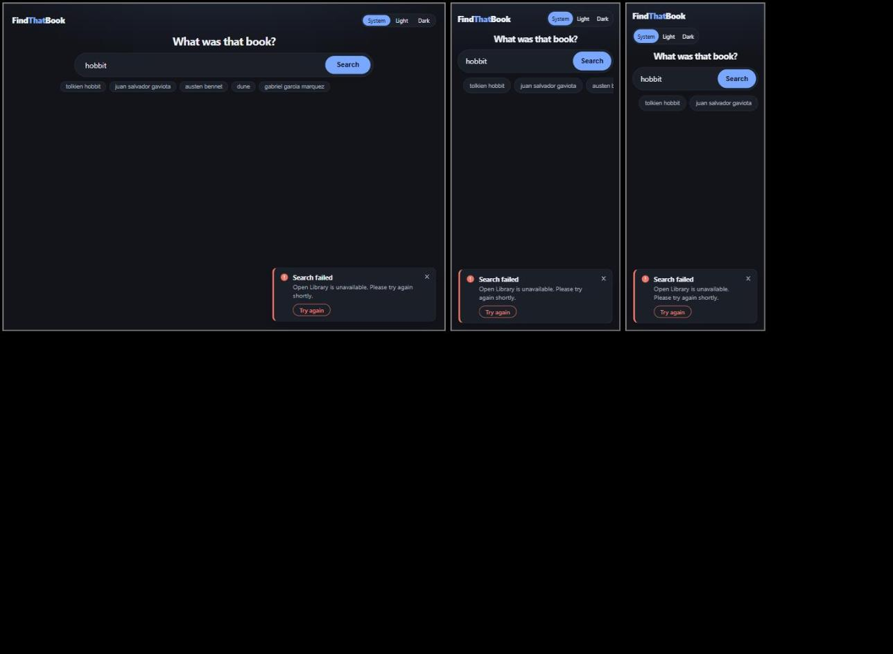
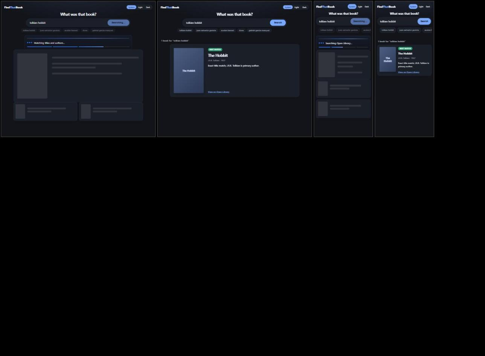
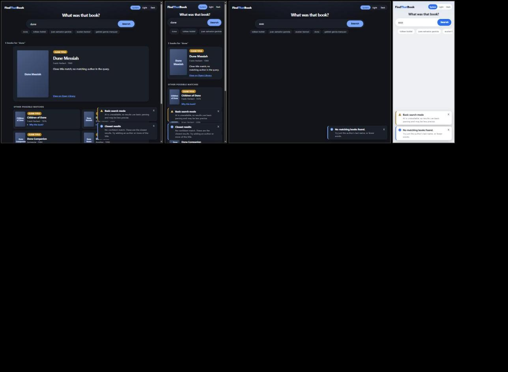

# UI Tests

Scope: the by-hand tests run on the featured results layout (UI spec D20) and the toast messages, what they showed, and what is still open. Decisions are in `docs/ui-proposals/ui-spec.md`. Date of the by-hand run: 2026-10-09 (third run, after the weak-match message and the empty state also became toasts).

## 1. By-hand tests

Environment: headed Chrome driven through the Claude in Chrome extension. The UI was the production build (`npm run build` in `web/`) served by the API on port 5090, with the values from `.env` (OpenAI-compatible provider). Query `tolkien hobbit`. The real search returned 5 books but the AI step fell back, so the "Basic search mode" toast showed on its own. The layout under test does not depend on that. The error, skeleton, single-result, weak-match and empty scenarios used a stubbed `fetch` inside the page, because those states cannot be triggered on demand with a healthy backend.

The browser window resize does not change the page viewport, so every width below the desktop shot was tested in a same-origin iframe of that width (the iframes were scaled down only for the screenshot). Media queries react to the iframe width, so this matches a real window of that width, but it does not test touch. Give each iframe `flex: none`, or a flex row shrinks it below its set width.

### 1.1 Matrix

| ID | Width | Theme | What was checked | Result |
|----|-------|-------|------------------|--------|
| T1 | Desktop (1451px window) | Dark | Layout, badges, covers, chips, notice toast | Pass |
| T2 | 1024px | Dark, light | Featured card 200px cover plus text, other matches in 2 columns, no horizontal overflow | Pass |
| T3 | 768px | Dark, light | Same as T2 | Pass |
| T4 | 390px | Dark, light | Featured card 110px cover, other matches in 1 column, chips scroll sideways, no horizontal overflow | Pass |
| T5 | 320px | Dark, light | Same as T4, title and reason wrap, no horizontal overflow | Pass |
| T6 | 1024, 768, 390, 320px | Light | Every "Why this book?" opened: reasons show inside the cards and do not break the layout | Pass |
| T7 | 1024, 768, 390, 320px | Dark, light | Badges, text and card borders readable | Pass |
| T8 | 1024, 390, 320px | Dark | Error toast (forced 502): announced as an alert, shows title, message, Try again and Dismiss, covers nothing | Pass |
| T9 | 390, 320px | Dark, light | Toasts sit at the bottom of the screen, cover no part of the logo, heading, search box or chips, and clear the last result at the end of the page (0px covered at 1024, 768, 390 and 320px) | Pass (failed in the first run, fixed, see F2) |
| T10 | 390px, 1024px | Dark | Dismiss removes the toast. Try again repeats the search, removes the error toast and shows the result (here the empty-state toast). Try again is focusable | Pass |
| T11 | 1024, 390px | Dark | Loading skeleton and the progress panel while a search runs, no overlap, no horizontal overflow | Pass |
| T12 | 1024, 390px | Dark | Single-result search: featured card only, no "Other possible matches" section | Pass |
| T13 | 1024, 390px | Dark, light | Empty state is an info toast with the message and the tip "Try just the author's last name, or fewer words.", no leftover text block, nothing covered | Pass |
| T14 | 1024, 390px | Dark | Weak-match message ("No confident match…") is an info toast titled "Closest results" next to the results | Pass |
| T15 | 1024, 768, 390, 320px | Dark, light | AI notice alone, info toast alone and both stacked: nothing covered at the end of the page, no horizontal overflow (24 combinations) | Pass |

Measured values (`getComputedStyle` and `scrollWidth`), dark theme:

| Width | Featured columns | Other matches columns | `scrollWidth` vs `clientWidth` |
|-------|------------------|-----------------------|-------------------------------|
| 1024 | 200px 582px | 424px 424px | 1024 = 1024 |
| 768 | 200px 450px | 358px 358px | 768 = 768 |
| 390 | 110px 208px | 362px | 390 = 390 |
| 320 | 110px 123px | 277px | 305 = 305 |

At 320px the page is taller than the iframe because of the bottom padding that is reserved while a toast shows, so it has a vertical scrollbar and the width is 305. In light mode with every reason open the same happens at 390px: the column widths are 110px 193px and 347px, and `scrollWidth` equals `clientWidth` at 375. The 1024 and 768px values are the same as in dark.

`clientWidth` is the iframe width minus its scrollbar when there is one. Equal values mean no horizontal overflow.

### 1.2 Screenshots

Desktop, dark, with the "Basic search mode" toast at the bottom right (T1):

1024, 768, 390 and 320px side by side, dark (T2 to T5, T9). The toast sits at the bottom at every width:

The same widths in light mode, scrolled to the results, with every reason opened (T6, T7):

The error toast at 1024, 390 and 320px, dark (T8, T9). On phones it spans the bottom of the screen and leaves the header, heading, search box and chips visible:

Loading skeleton and a single-result search at 1024 and 390px, dark (T11, T12):

Left to right: weak-match results with the AI notice stacked above the info toast at 1024px and at 390px (dark), the empty-state toast at 1024px (dark), and the empty-state toast with the AI notice at 390px (light). The toasts are fixed to the screen, so on the two left frames they float over the results (T13, T14, T15):

## 2. Findings

| ID | Finding | Severity | Status |
|----|---------|----------|--------|
| F1 | On desktop the featured card has an empty gap between the explanation and the "View on Open Library" link, because the link sits at the bottom of the card next to the tall cover | Low, cosmetic | Open |
| F2 | On phones (390px and 320px) the toast was fixed at the top of the screen and covered the logo, the theme toggle and the heading. The error toast at 390px also covered the Search button and part of the search box. Fix: on phones the toast now sits at the bottom, and while any toast is showing the page gets 260px of bottom padding (`.page:has(.toast)`) so the last result is not hidden behind the stack. Re-measured at 1024, 768, 390 and 320px in dark and light, with the AI notice alone, the weak-match info toast alone and both together: no overlap with the header, heading, search box or chips, and 0px of the last result covered at the end of the page | Medium | Fixed |
| F3 | `/api/health/ready` reported the OpenAI-compatible endpoint as `ok` (the `GET /models` probe passed), but the real search fell back to non-AI parsing and showed the "Basic search mode" toast again in this run. The probe does not prove that the chat call works. The cause of the failed AI call was not investigated | Medium | Open |
| F4 | A search with no results leaves the area under the search box blank, and the only message is a toast in the corner. After the toast is dismissed the page shows nothing about the search. This is a side effect of turning the empty state into a toast | Low, design | Open |

## 3. Not tested (pending)

| ID | Item | Why it matters |
|----|------|----------------|
| P1 | Real touch behavior on a phone | Iframes do not trigger `hover: none`, and the `
` tap target is only measured by its CSS (36px minimum). The toast dismiss target is a 1.3rem glyph with 4px side padding and its size was not measured. A toast at the bottom of a real phone screen may also sit behind the browser's bottom bar, which iframes cannot show |
| P2 | The loading skeleton in light mode and at 768 and 320px | Only dark at 1024 and 390px was seen |
| P3 | A single-result search in light mode | Only dark at 1024 and 390px was seen |
| P4 | The error toast in light mode, and the weak-match and empty-state toasts at 768 and 320px | The error toast was only seen in dark. The empty-state toast was seen at 1024 (dark) and 390px (light) only |
| P5 | Widths below 320px, and landscape phones | The old layout had a 340px breakpoint, the new one has only 760px |
| P6 | Screen reader behavior of the heading order (`h2` count, `h3` featured title and "Other possible matches", `h4` card titles), of the `
` disclosure and of the toast announcements | Checked by reading the markup and by unit tests, not with a screen reader |
| P7 | Keyboard walk through the page (Tab order, focus ring on the covers, links, `summary` and the toast buttons) | Only focusing Try again from script was tried, not a real Tab walk |
| P8 | The prototype variants (shelf, ranked list, featured plus rest, and the four message styles: banners, toast, balloon, modal) were not kept on a throwaway branch | The comparison cannot be repeated without rebuilding them |
| P9 | A real failed search, without a stubbed `fetch`, and a real weak-match or empty search | These states were only seen with a stubbed response |
| P10 | `.page:has(.toast)` in a browser without `:has()` support | Without it the page keeps its normal bottom padding and the last result can sit behind the toasts at the end of the page |

## 4. How to repeat the by-hand run

1. Build the UI: `npm run build` in `web/`.
2. Start the API with the UI as web root, for example `ASPNETCORE_WEBROOT=<repo>/web/dist ASPNETCORE_URLS=http://localhost:5090 dotnet run --project src/FindThatBook.Api --no-launch-profile`. Pass the AI settings as environment variables, because `dotnet run` does not read `.env`.
3. Open `http://localhost:5090/?q=tolkien%20hobbit`.
4. For each width, put the page in an iframe of that width (`flex: none`) and set `data-theme` on the iframe's `<html>` to `light` or `dark`. Check `document.documentElement.scrollWidth` equals `clientWidth`.
5. Open every `
` and scroll to the results.
6. For the toast, skeleton, single-result, weak-match and empty scenarios, replace `fetch` on the iframe's window before submitting the form:
   - error toast: a 502 problem-details response (`application/problem+json`)
   - skeleton: a promise that never resolves
   - single result: a response with one result
   - weak match: a response with `message` set to the "No confident match…" text and several results
   - empty state: a response with `message` "No matching books found." and `results: []`
7. At the end of the page, check that the top of every toast is below the bottom of the last result card.
