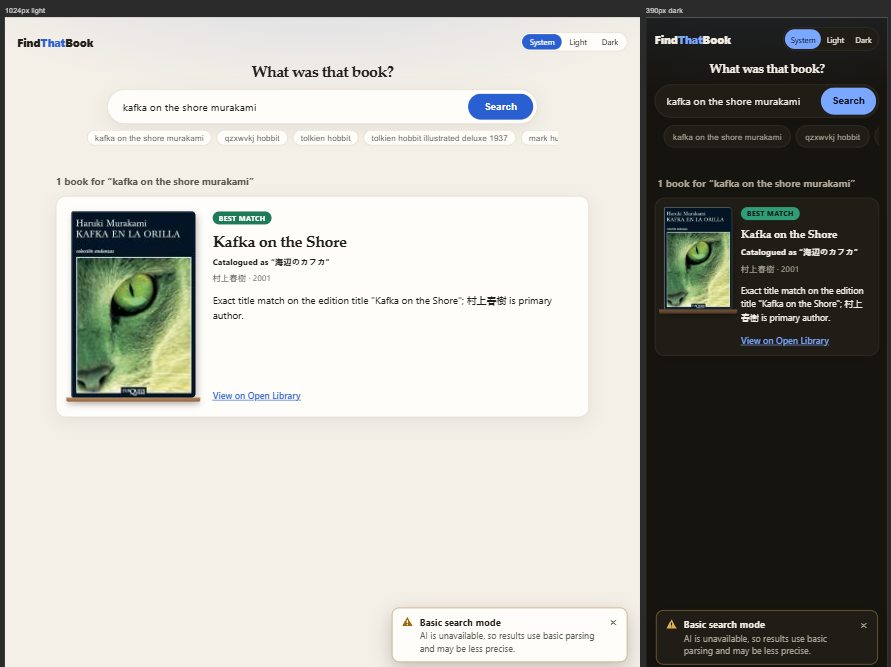
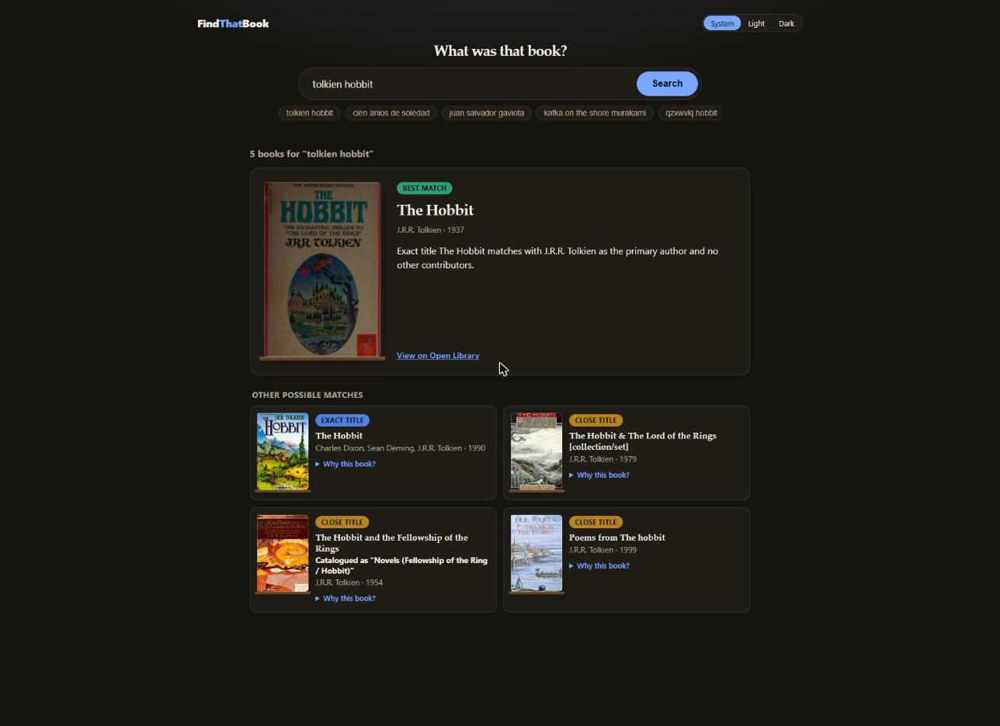

# UI Tests

Scope: the by-hand tests run on the featured results layout (UI spec D20), the toast messages, the search progress stage and the polish rounds after them (warm palette, ledge under every cover, edition title headline, focus return, 24px tap targets), what they showed, and what is still open. Decisions are in `docs/ui-proposals/ui-spec.md`. Date of the by-hand run: 2026-10-14 (twelfth run, on a production build rebuilt in Docker from the current source, which now also has the AI generation settings: temperature, top-k, top-p, seed and reasoning effort. Every case T1 to T31 and every one of the 12 screenshots was repeated, case T32 (AI mode) and screenshot 13 were added, and all results match the eleventh run except the differences noted below).

## 1. By-hand tests

Environment: headed Chrome driven through the Claude in Chrome extension. The UI was the production build served by the API from the Docker image (`docker compose up --build -d app`, http://localhost:8080), so this run also covers the image build and the static files the API serves. The container's pages refuse to be shown in a frame (the framing headers are enforced, see the harness notes), so the scenarios that need iframes (T2 to T26) used the same production build files, copied out of the image (`docker create` and `docker cp` of `/app/wwwroot`) and served on http://localhost:5199 by a small static server that sends no framing headers and forwards `/api` to the container. The scenarios about headers, compression and the rate limit (T28, T30, T31) and the first desktop scenarios (T1, T27) used the container itself. T32 ran first, with the AI settings from `.env`. For every other scenario the API ran with no AI settings (the AI keys and the generation settings were blanked with environment variables), so every real search used basic parsing. Real queries: `tolkien hobbit` (5 books), `kafka on the shore murakami` (1 book, matched through an edition title) and `qzxwvkj plmnb` (no results). The error, loading, single-result, weak-match and some empty scenarios used a stubbed `fetch` inside the page, because those states cannot be triggered on demand with a healthy backend.

The browser window resize does not change the page viewport, so every width below the desktop shot was tested in a same-origin iframe of that width (the iframes were scaled down only for the screenshot, then the screenshot was cropped to the frames). Media queries react to the iframe width, so this matches a real window of that width, but it does not test touch. Give each iframe `flex: none`, or a flex row shrinks it below its set width. In this run the Chrome tab reported `document.visibilityState` as `visible` and `prefers-reduced-motion: reduce` (the operating system setting, which differs from the tenth run). The stage timers still run under that setting, so the stage could be checked in real time (T19, T21), but its scenes only animate with the 3 reduced-motion media rules switched off in the frame (`media.mediaText = "not all"`), which T16 and T18 did. T20 used the real setting with nothing forced. Harness effects to know about:

- Build the harness page on `/landing.html` of the static server (port 5199), which has no policy at all. On the container, `/api/health` and the app pages have a Content-Security-Policy without `unsafe-inline` for styles, so a harness `<style>` is ignored there and the frames stack instead of sitting in a row. The container's own `/landing.html` allows inline styles, but its frames are refused (next bullet).
- In the eleventh run an iframe `src` with a `?q=` query string did not load for some queries (the frame stayed blank and `contentDocument` was `null`, while `/` and `/?q=tolkien+hobbit` loaded). The cause was not found, and it may have been the same framing block, enforced only some of the time. Load `/` and submit the query through the form instead, with the real `fetch` for real searches. This run did that for every frame.
- The container's pages cannot be framed. Every response carries `X-Frame-Options: DENY` and `frame-ancestors 'none'`, and in this run every iframe of `/`, `/index.html`, `/landing.html` and `/api/health` stayed blank (`contentDocument` was `null`), as it should. In the eleventh run the same iframes loaded, which was never explained (it was open item P11, now resolved). For this reason the harness page and its frames came from the static server on port 5199 (see the environment paragraph above).
- The `computer` tool's `zoom` action with a region and `save_to_disk` saves a cropped image, so the "composite page, then crop" step was done in one call.

- The theme toggle syncs through `localStorage` `storage` events, so frames that need different themes cannot be built with different saved themes (the earlier frames flip). Build every frame with one theme, then set `data-theme` on each iframe's `<html>`. The toggle in those frames then highlights the saved theme, not the shown one. That is a test harness effect, not a product bug.
- Calling `focus()` in several iframes at once makes each frame take focus from the previous one, so only the last frame keeps `document.activeElement`. Focus checks (T10) were done in a frame on its own.
- The screenshot call (`Page.captureScreenshot`) times out after 30 seconds when the page is static, because the headed Chrome tab produces no new frame. It worked right after a navigation and on pages with running animations. Fix: add a 6px element with an infinite CSS animation to the harness page, then every capture succeeds.
- The extension's script tool stops a call after 45 seconds, so the real-time run (T21) logged step changes from an interval in the page and was read back afterwards.

The step durations were checked two ways: by reading the timers the component queued (`setTimeout` in the iframe was wrapped to record the 10000, 2000, 1000 and 30000 ms timers and fire them on demand, which also gave exact stills), and in real time. Motion was checked by pausing every stage animation and stepping its `currentTime`. For the reduced-motion check (T20) the `@media (prefers-reduced-motion: reduce)` rules were forced on inside the iframe by setting each rule's `media.mediaText` to `all`.

### 1.1 Matrix

| ID | Width | Theme | What was checked | Result |
|----|-------|-------|------------------|--------|
| T1 | Desktop (1718px window) | Dark | Layout, serif headline, badges, covers on their ledge, chips, notice toast | Pass |
| T2 | 1024px | Dark, light | Featured card 200px cover plus text, other matches in 2 columns, no horizontal overflow | Pass |
| T3 | 768px | Dark, light | Same as T2 | Pass |
| T4 | 390px | Dark, light | Featured card 110px cover, other matches in 1 column (88px covers), chips scroll sideways, no horizontal overflow | Pass |
| T5 | 320px | Dark, light | Same as T4, title and reason wrap, no horizontal overflow | Pass |
| T6 | 1024, 768, 390, 320px | Light | Every "Why this book?" opened (4 of 4): reasons show inside the cards and do not break the layout | Pass |
| T7 | 1024, 768, 390, 320px | Dark, light | Badges, text and card borders readable | Pass |
| T8 | 1024, 390, 320px | Dark | Error toast (forced 502): `role="alert"`, shows title, message, Try again and Dismiss, overlaps none of the logo, heading, search box or chips, and the icon mark is dark on the toast color in the dark theme (stroke rgb(11, 18, 32)) | Pass |
| T9 | 1024, 768, 390, 320px | Dark, light | Toasts sit at the bottom of the screen and clear the last result at the end of the page (0px covered, see T15) | Pass |
| T10 | 1024, 390px | Dark | Dismiss removes the toast. Try again is focusable, repeats the search, removes the error toast and shows the result (here the empty-state toast and the bookshelf), and focus ends on the search box | Pass |
| T11 | 1024 (dark), 768, 390, 320px (light) | Dark, light | Search progress stage while a search runs: it replaces the results, no skeleton, nothing overlaps, no horizontal overflow | Pass |
| T12 | 1024, 390px | Dark, light | Single-result search: featured card only, no "Other possible matches" section, no toast | Pass |
| T13 | 1024, 390px | Dark, light | Empty state is an info toast titled "No matching books found." with the tip "Try just the author's last name, or fewer words." (the server's own advice is not repeated), no leftover text block, and no "Basic search mode" toast next to an empty result | Pass |
| T17 | 1024, 390, 320px | Dark, light | Empty state also shows the empty bookshelf picture under the search box, the toast is below it, no horizontal overflow. A real empty search (`qzxwvkj plmnb`, no stub) in five frames at once shows it too and finished in 8.6 seconds (the container was freshly built, so nothing was cached, as in the eleventh run, the ninth run took 12 seconds uncached and the tenth 0.5 seconds cached). The five frames typed the query into the form, with the real `fetch` going through the static server to the container | Pass |
| T14 | 1024, 390px | Dark | Weak-match message ("No confident match…") is an info toast titled "Closest results", stacked under the "Basic search mode" toast next to the results | Pass |
| T15 | 1024, 768, 390, 320px | Dark, light | AI notice alone, info toast alone and both stacked, 24 cases: 0px of the last result covered at the end of the page in every case, no horizontal overflow, 1, 1 and 2 toasts | Pass |
| T16 | 390px | Dark | The four steps show in order, each with its own animated scene (magnifier over the query, library with radar rings, clues linked to book spines, quill writing lines), a title, a detail line and four chips that go from pending to active to done. At 390px the chips sit in a 2×2 grid | Pass |
| T18 | 390px | Dark | Motion (with the 3 reduced-motion media rules switched off in the frames, because this Chrome has reduced motion on): every stage animation changes value when stepped through 3 seconds in 125ms samples (25 samples): 10 of 10 on the Understand scene, 9 of 9 on Search, 11 of 11 on Match, 8 of 8 on Explain (each count includes the entrance animation, the two fade-ups and the active-chip pulse). Four frames with their animations set to 0.3, 1.0, 1.7 and 2.4 seconds show the lens, the highlighted text lines, the sparkles and the chip pulse at different moments | Pass |
| T19 | 390px | Dark | Slow state: after the last step all four chips are done, the title reads "Still working, this is taking longer than usual…", the detail reads "Open Library or the AI gateway may be slow right now.", and the last scene stays. In real time it appeared 44.6 s after the search started (43.1 s in the previous runs. The timer was probably delayed by the screenshot calls made during the run) | Pass |
| T20 | 390px | Dark | Reduced motion with the browser's real setting (`matchMedia("(prefers-reduced-motion: reduce)")` was true, nothing forced): 0 stage animations were running on the Understand step (the tenth run forced the 3 rules on and counted 10 dropping to 0), and the text, chips and step changes still work (the next step title appeared after firing its timer) | Pass |
| T21 | 390px | Dark | Step durations: the four frames, each on its own step, had queued timers of 10000 ms (Understand), 2000 ms (Search), 1000 ms (Match) and 30000 ms (Explain). In real time the steps changed at 10.1, 12.1, 13.1 and 44.6 s (the last one 1.5 s later than in the earlier runs, see T19) | Pass |
| T22 | 1024, 390px | Light, dark | Edition title headline: the real query `kafka on the shore murakami` shows the matched edition title "Kafka on the Shore" as the headline, a bold "Catalogued as “海辺のカフカ”" line under it, the reason, and the cover. The page title reads "1 book for “kafka on the shore murakami” · Find That Book". The featured card has one tab stop to Open Library: the cover link is hidden from assistive tech with `tabindex="-1"` and the text link reads "View on Open Library (opens in a new tab)". No overflow | Pass |
| T23 | 1024, 390px | Dark | After a search ends with an error or no results, focus returns to the search box (measured after the Try again retry in T10) | Pass |
| T24 | 1024, 390px | Dark | Tap targets (`getBoundingClientRect`). At 1024px: Search 105×42, chips 25 high, theme buttons 25, "Why this book?" 298×25, toast close 24×24, runner-up covers 88×132. At 390px: Search 89×44, chips 36, theme buttons 32, "Why this book?" 221×44, toast close 24×24, featured cover 110×165 | Pass |
| T25 | 1024px | Dark | The "Basic search mode" notice shows with results, and after it is dismissed it does not return on the next search | Pass |
| T26 | 390px | Dark | A cover image that fails to load (a missing URL) is replaced by the generated cover with the book's title | Pass |
| T27 | 1718px window, real click | Dark | The logo is a link (`a`, `href="/"`, label "Find That Book, home"). Clicking it from a results page (`?q=tolkien hobbit`) reloads the page at `http://localhost:8080/` with an empty search box (the placeholder shows), no results, the page title "Find That Book" and the full hero | Pass |
| T28 | Not applicable | Not applicable | Response compression (measured with curl): with `Accept-Encoding: gzip` the script is 102,492 bytes (234,314 plain) and the stylesheet 6,120 bytes (15,612 plain), both with `Content-Encoding: gzip`. With `Accept-Encoding: br` they are 91,858 and 5,231 bytes with `Content-Encoding: br`. `/api/health` is gzipped too. The tenth run recorded 85,311 and 4,977 bytes for gzip, which this run did not reproduce with the same plain sizes, so those two figures are replaced (the earlier measuring method was not recorded) | Pass |
| T29 | 1024px | Dark | The two `theme-color` metas are `#f4efe7` (light) and `#16140f` (dark), the same as the page backgrounds | Pass |
| T30 | 1718px window, real typing | Dark | Security headers on the production build. With curl, `/`, `/?q=…`, `/index.html`, a static script, `/api/health` and `/landing.html` each carry `X-Content-Type-Options: nosniff`, `X-Frame-Options: DENY`, `Permissions-Policy: camera=(), microphone=(), geolocation=(), payment=(), usb=(), interest-cohort=()` and a Content-Security-Policy (the landing page has its own, with inline script and styles allowed). In Chrome, a fresh load and a real search (`tolkien hobbit`) logged no console message matching `Content Security`, `Refused`, `violat`, `Permissions`, `error` or `Failed`, and all 5 cover images loaded | Pass |
| T31 | Not applicable (curl) | Not applicable | The two code-review fixes the unit tests could not show live. `POST /api/search/` (trailing slash) with 13 blank queries in one minute returned 10 × 400 then 3 × 429, so the limit now applies to that path. A 9,000-byte body to `/api/search` returned 413 `application/problem+json` carrying `nosniff`, `X-Frame-Options`, `Permissions-Policy` and the Content-Security-Policy (the 413 had none of them before the fix) | Pass |
| T32 | 1718px window, real typing | Dark (system) | AI mode, the case earlier runs could not cover. The stack ran with the AI settings from `.env`: provider `OpenAiCompatible` (`api.x.ai`, `grok-4.7`), temperature 0, top-p 0.95, seed 93756 and reasoning effort `low`. A real search for `tolkien hobbit` took 14.5 s and returned HTTP 200 with `aiUsed: true`, 5 books and no message. The page showed no "Basic search mode" toast. The explanations were written by the model ("Exact title The Hobbit matches with J.R.R. Tolkien as the primary author and no other contributors.") and the featured card shows that sentence. The fourth result carries a "Catalogued as" line for its edition title. The page title and the focused results heading were the same as in basic mode | Pass |

Measured values (`getComputedStyle`, `scrollWidth` and `clientWidth`), dark theme, iframes 1060px tall, unchanged from the previous run:

| Width | Featured columns | Other matches columns | `scrollWidth` vs `clientWidth` |
|-------|------------------|-----------------------|-------------------------------|
| 1024 | 200px 582px | 424px 424px | 1009 = 1009 |
| 768 | 200px 435px | 350.5px 350.5px | 753 = 753 |
| 390 | 110px 193px | 347px | 375 = 375 |
| 320 | 110px 123px | 277px | 305 = 305 |

The light theme gave the same values at every width. `clientWidth` is the iframe width minus its 15px vertical scrollbar. The page is taller than the iframe at every width in the results frames, so the scrollbar is there. Equal values mean no horizontal overflow.

### 1.2 Screenshots

Desktop, dark, with the "Basic search mode" toast at the bottom right (T1):

1024, 768, 390 and 320px side by side, dark (T2 to T5, T9). The toast sits at the bottom of each frame, over the last row of cards because the frames are shorter than the page:

The same widths in light mode, scrolled to the results, with every reason opened (T6, T7):

The error toast at 1024, 390 and 320px, dark (T8, T9). On phones it spans the bottom of the screen and leaves the header, heading, search box and chips visible, and the icon mark is dark on the red. In the 320px frame the search box has the focus ring because focus returned to it (T23):

The four steps of the search progress stage at 390px, dark, left to right (T16). Each frame was moved to its step by firing its step timer, and the shot was taken about 1.5 seconds after the last change, so each scene is mid-animation. The step chips form a 2×2 grid at this width:

The stage on the Search step while a search runs at 1024px (dark), and at 768, 390 and 320px (light) (T11). The results area is the stage itself, no skeleton is shown:

A single-result search at 1024 and 390px, dark and light (T12), no toast:

Left to right: weak-match results with the AI notice stacked above the info toast at 1024px and at 390px (dark), the empty state at 1024px (dark, toast and bookshelf), and the empty state at 390px (light). The empty state no longer shows the AI notice. The toasts are fixed to the screen, so on the two left frames they float over the results (T13, T14, T15):

The stage with motion on at 390px, dark, step 1 (T18). Four frames with their animations paused at 0.3, 1.0, 1.7 and 2.4 seconds, so they show four moments: the lens is at a different place each time, and the highlighted lines, the sparkles and the chip pulse differ:

The slow state after the last step at 390px, dark (T19). The quill is still writing:

The empty state with the bookshelf picture at 1024px (dark), 390px (dark), 1024px (light), 390px and 320px (light) (T17, F4). All five frames ran a real search (`qzxwvkj plmnb`, no stub) at the same time and finished after 8.6 seconds (nothing cached):

The edition title result for the real query `kafka on the shore murakami`, at 1024px (light) and 390px (dark) (T22). The headline is the edition title the reader typed, with the stored title beneath it:

AI mode at 1718px (the system dark theme) with the real query `tolkien hobbit` (T32). There is no "Basic search mode" toast, and the sentence on the featured card was written by the model. The fourth card shows the "Catalogued as" line for its edition title:

## 2. Findings

| ID | Finding | Severity | Status |
|----|---------|----------|--------|
| F1 | On desktop the featured card has an empty gap between the explanation and the "View on Open Library" link, because the link sits at the bottom of the card next to the tall cover. Still visible in this run. Left as is on purpose | Low, cosmetic | Open |
| F2 | On phones the toast was fixed at the top of the screen and covered the logo, the theme toggle and the heading. Fix: on phones the toast now sits at the bottom, and while a toast is showing the page gets 150px of bottom padding (260px when two toasts stack) so the last result is not hidden behind the stack. Re-measured in this run at 1024, 768, 390 and 320px in dark and light (T15): 0px of the last result covered in all 24 cases | Medium | Fixed |
| F3 | `/api/health/ready` reported the OpenAI-compatible endpoint as `ok` (the `GET /models` probe passed), but the real search fell back to non-AI parsing in an earlier run. The probe does not prove that the chat call works. This run had no AI settings, so it was not retested | Medium | Open |
| F4 | A search with no results left the area under the search box blank, and the only message was a toast in the corner. Fix: the empty state also shows a picture of a mostly empty bookshelf (`EmptyShelf`, an inline SVG with `role="img"`) under the search box. It stays after the toast is dismissed. The message itself is still only the toast. Checked at 1024, 390 and 320px in dark and light (screenshot 09) with real searches | Low, design | Fixed |
| F5 | The result for `kafka on the shore murakami` shows the author in the script Open Library stores (村上春樹) and the Spanish edition cover, so an English reader may not recognize the byline. The headline now shows the matched edition title, but names are shown as stored. Known limitation in the README ("With more time") | Low, data | Open |

## 3. Not tested (pending)

| ID | Item | Why it matters |
|----|------|----------------|
| P1 | Real touch behavior on a phone | Iframes do not trigger `hover: none`. Tap targets were measured from the layout (T24), not by tapping. A toast at the bottom of a real phone screen may also sit behind the browser's bottom bar, which iframes cannot show |
| P2 | The error toast in light mode, and the empty-state toast at 768px | The error toast was only seen in dark. The empty-state toast was seen at 1024, 390 and 320px |
| P3 | Widths below 320px, and landscape phones | The layout has a 760px breakpoint, a 600px one for the toasts and a 420px one for the header and step chips |
| P4 | Screen reader behavior of the heading order (`h2` count or stage title, `h3` featured title and "Other possible matches", `h4` card titles), of the `
` disclosure, of the stage status region and of the toast announcements | Checked by reading the markup and by unit tests, not with a screen reader |
| P5 | A real keyboard walk through the page (Tab order, focus ring on the covers, links, `summary` and the toast buttons) | Focus was set from script and the ring was read from the computed style, not walked with real Tab presses |
| P6 | Progress stage motion quality: motion was checked by stepping each animation's `currentTime` and by stills, not by watching or recording it | Stepping proves the scenes move, it does not show smoothness, frame rate or flicker |
| P7 | The earlier shelf, ranked list and featured plus rest layout prototypes and the four message styles (banners, toast, balloon, modal) were not kept on a throwaway branch. The progress variants (current panel, stage, floating dock, shelf) are on the branch `prototype/search-progress-variants`, switch with `?variant=A` to `D` | The older comparisons cannot be repeated without rebuilding them |
| P8 | A real failed search and a real weak-match search, without a stubbed `fetch` | These states were only seen with a stubbed response. A real empty search was checked in the UI (T17) |
| P9 | `.page:has(.toast)` in a browser without `:has()` support | Without it the page keeps its normal bottom padding and the last result can sit behind the toasts at the end of the page |
| P12 | The AI scenarios of this document in AI mode: the progress stage with a real AI gateway, and the error and fallback toasts caused by a real AI failure (for example a provider timeout) | T32 covered one successful AI search only. A real AI timeout makes the search wait about 30 seconds and then fall back to basic parsing. That was seen in the API log in an earlier call tree run, not in the UI |

Resolved by the ninth run and confirmed again in this one: the production build served by the API and the Docker image (the image built and served the app, so the README limitation about it was out of date), and the step timing in real time in a visible window (T21). This run also built the image with `npm ci --ignore-scripts` and the pinned base images, and the UI worked, so that Dockerfile change is confirmed by a real build. The Jaeger digest pin was exercised by the call tree runs (`docs/call-tree-analysis.md`), not by this one, which started the `app` service only.

Resolved in this run: P10, the AI mode check (T32: `aiUsed: true`, no "Basic search mode" toast, model-written explanations, screenshot 13). P11, that a browser refuses to show the app in a frame: every iframe of the container's pages stayed blank (see the harness notes), so `X-Frame-Options: DENY` and `frame-ancestors 'none'` are enforced. The eleventh run's frames that loaded stay unexplained.

No new defect in the UI was found in this run. The code-review fixes and the AI generation settings behaved as intended in the browser and with curl (T30, T31, T32).

## 4. How to repeat the by-hand run

1. Start the app: `docker compose up --build` (http://localhost:8080). Or run the dev setup: `npm run dev` in `web/` (http://localhost:5173) with `dotnet run --project src/FindThatBook.Api` (http://localhost:5080). Pass the AI settings as environment variables if you want AI explanations, because `dotnet run` does not read `.env`. For the basic-mode scenarios blank the AI keys and the generation settings (`AI_PROVIDER=Gemini GEMINI_API_KEY= OPENAI_API_KEY= AI_SEED= AI_REASONING_EFFORT= AI_TOP_P= docker compose up --build -d app`). For T32 start the stack with the AI settings from `.env` and search once.
2. Open the app in a visible Chrome window and check `document.visibilityState` is `visible`, otherwise timers and animations are throttled.
3. For each width, put the page in an iframe of that width (`flex: none`). The container's pages refuse to be framed, so serve the production build from another port: copy it out of the image (`docker create --name tmp find-that-book`, `docker cp tmp:/app/wwwroot .`, `docker rm tmp`) and serve it with a static server that forwards `/api` to http://localhost:8080 and sends no framing headers (a 20 line Node script does it). Build the harness on `/landing.html` of that server. Build every frame with one saved theme, then set `data-theme` on each iframe's `<html>` to `light` or `dark`. Check `document.documentElement.scrollWidth` equals `clientWidth`.
4. Open every `
` and scroll to the results.
5. For the toast, loading, single-result, weak-match and empty scenarios, replace `fetch` on the iframe's window (assigning a function that returns `new w.Response(...)` works and needs no `eval`, which the Content-Security-Policy would not allow) before submitting the form (set the input with the native value setter and dispatch an `input` event, because React ignores a plain assignment):
   - error toast: a 502 problem-details response (`application/problem+json`) with a `title`
   - loading stage: a promise that never resolves. The steps last 10, 2, 1 and 30 seconds, and the slow state shows after 43 seconds. To see all four steps at once, wrap `setTimeout` in the iframe so it records the timers with 10000, 2000, 1000 and 30000 ms and fire them by hand, one frame per step. If the browser has reduced motion on, switch the reduced-motion media rules off in the iframe (`media.mediaText = "not all"`) to see the animations, and force them on (`"all"`) to check the reduced state
   - single result: a response with one result
   - weak match: a response with `aiUsed: false`, `message` set to the "No confident match…" text and several results
   - empty state: a response with `message` "No matching books found." and `results: []`
   - AI notice: `aiUsed: false` with at least one result. It does not show next to an empty result
6. At the end of the page, check that the top of every toast is below the bottom of the last result card (the run script measured `last card bottom − toast top`).
7. Real searches: `tolkien hobbit` (5 books), `kafka on the shore murakami` (edition title) and `qzxwvkj plmnb` (empty). Open Library throttles heavy use, so repeat queries rather than adding new ones.
8. Screenshots: take the composite page, then crop it to the frames (the `zoom` action with a region and `save_to_disk` does both in one call). Keep the file names so the links above stay valid. If the capture times out on a static page, add an element with an infinite CSS animation to the harness page first (see the harness effects above).
