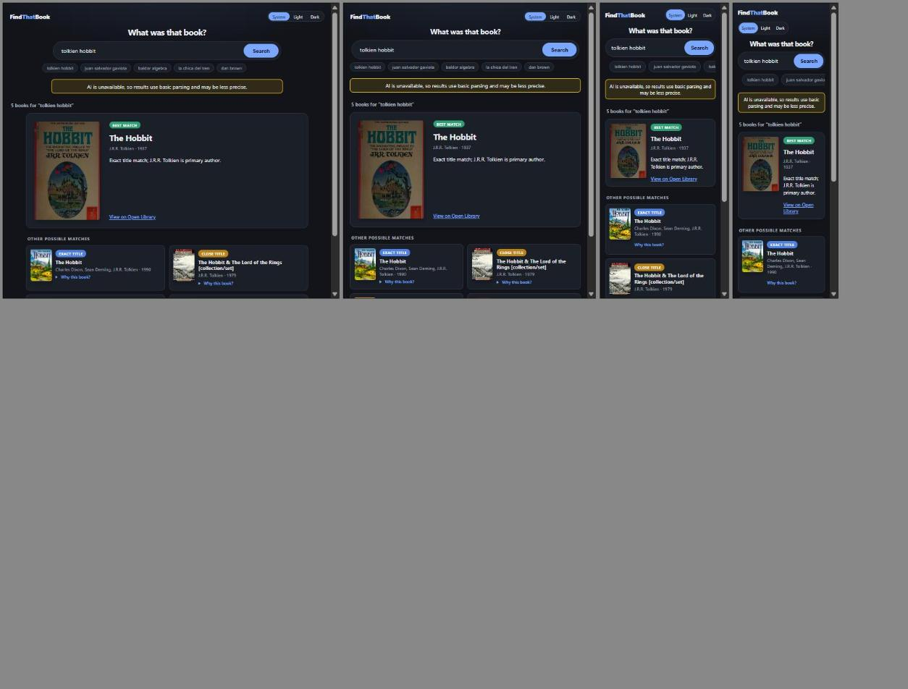
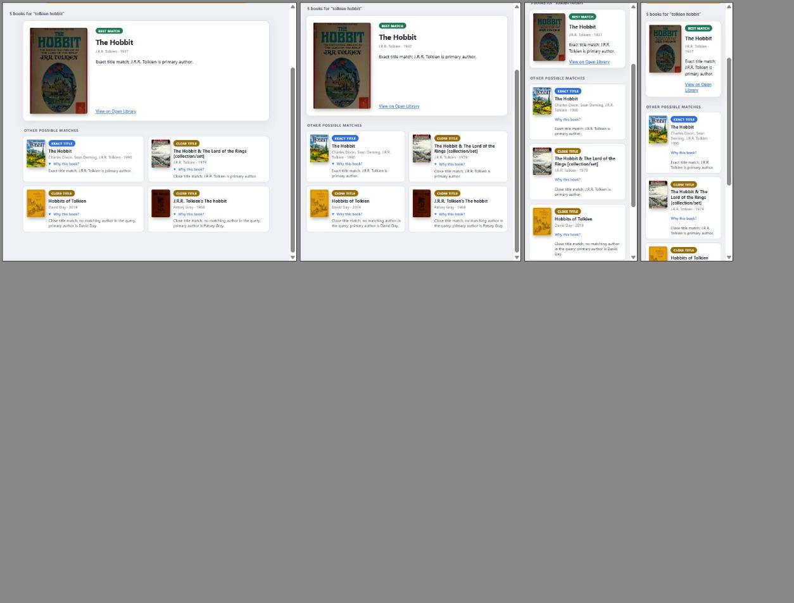

# UI Tests

Scope: the by-hand tests run on the featured results layout (UI spec D20), what they showed, and what is still open. Decisions are in `docs/ui-proposals/ui-spec.md`. Date of the by-hand run: 2026-10-09.

## 1. By-hand tests

Environment: headed Chrome, Vite dev server (`npm run dev`, port 5174), API on port 5080, query `tolkien hobbit`. The AI gateway was unavailable, so the page showed the "AI is unavailable" notice and used basic parsing. The layout under test does not depend on that.

The browser window resize did not change the page viewport, so every width below the desktop shot was tested in a same-origin iframe of that width. Media queries react to the iframe width, so this matches a real window of that width, but it does not test touch.

### 1.1 Matrix

| ID | Width | Theme | What was checked | Result |
|----|-------|-------|------------------|--------|
| T1 | Desktop (full window) | Dark | Layout, badges, covers, chips, notice | Pass |
| T2 | 1024px | Dark, light | Featured card 200px cover plus text, other matches in 2 columns, no horizontal overflow | Pass |
| T3 | 768px | Dark, light | Same as T2 | Pass |
| T4 | 390px | Dark, light | Featured card 110px cover, other matches in 1 column, chips scroll sideways, no horizontal overflow | Pass |
| T5 | 320px | Dark, light | Same as T4, title and reason wrap, no horizontal overflow | Pass |
| T6 | 1024, 768, 390, 320px | Light | Every "Why this book?" opened: reasons show inside the cards and do not break the layout | Pass |
| T7 | 1024, 768, 390, 320px | Dark, light | Badges, text and card borders readable | Pass |

Measured values (`getComputedStyle` and `scrollWidth`):

| Width | Featured columns | Other matches columns | `scrollWidth` vs `clientWidth` |
|-------|------------------|-----------------------|-------------------------------|
| 1024 | 200px 582px | 424px 424px | 1009 = 1009 |
| 768 | 200px 435px | 350.5px 350.5px | 753 = 753 |
| 390 | 110px 193px | 347px | 375 = 375 |
| 320 | 110px 123px | 277px | 305 = 305 |

`clientWidth` is the iframe width minus its scrollbar. Equal values mean no horizontal overflow.

### 1.2 Screenshots

Desktop, dark (T1):

1024, 768, 390 and 320px side by side, dark (T2 to T5):

The same widths in light mode, scrolled to the results, with every reason opened (T6, T7):

## 2. Findings

| ID | Finding | Severity | Status |
|----|---------|----------|--------|
| F1 | On desktop the featured card has an empty gap between the explanation and the "View on Open Library" link, because the link sits at the bottom of the card next to the tall cover | Low, cosmetic | Open |

## 3. Not tested (pending)

| ID | Item | Why it matters |
|----|------|----------------|
| P1 | Real touch behavior on a phone | Iframes do not trigger `hover: none`, and the `
` tap target is only measured by its CSS (36px minimum) |
| P2 | The loading skeleton (`ResultsSkeleton`) in any width or theme | The page had already loaded when the checks ran. It replaces the old shelf skeleton |
| P3 | A single-result search | The "Other possible matches" section must be absent. Covered by a unit test, not seen in a browser |
| P4 | Empty state and error banner with Try again | Both are unchanged but share the page with the new layout |
| P5 | Widths below 320px, and landscape phones | The old layout had a 340px breakpoint, the new one has only 760px |
| P6 | Screen reader behavior of the heading order (`h2` count, `h3` featured title and "Other possible matches", `h4` card titles) and of the `
` disclosure | Checked by reading the markup and by unit tests, not with a screen reader |
| P7 | Keyboard walk through the page (Tab order, focus ring on the covers, links and `summary`) | Focus styles were added to CSS but not tried |
| P8 | The prototype variants (shelf, ranked list, featured plus rest) were not kept on a throwaway branch | The comparison cannot be repeated without rebuilding them |

## 4. How to repeat the by-hand run

1. Start the API: `dotnet run --project src/FindThatBook.Api`.
2. Start the UI from `web/`: `npm run dev` and open the printed URL with `/?q=tolkien%20hobbit`.
3. For each width, put the page in an iframe of that width and set `data-theme` on the iframe's `<html>` to `light` or `dark`. Check `document.documentElement.scrollWidth` equals `clientWidth`.
4. Open every `
` and scroll to the results.
